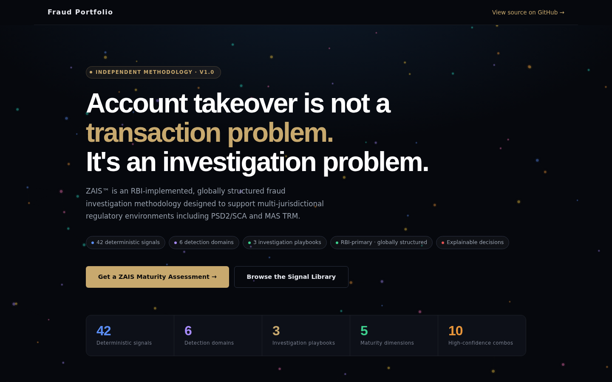

# ATO Investigation Standard

**Status:** Signal library v2.1 (production) · Independent open-source project

**Documentation:** [LICENSE](./LICENSE)

Maintained by **Gururaj G J** — Senior Fraud Risk | Merchant Risk | Financial Crime Professional
[LinkedIn](https://www.linkedin.com/in/gururaj-gj-52a062b4/) · [GitHub](https://github.com/Gururaj-GJ-G)

---

## What it is

A structured account-takeover (ATO) investigation methodology: **42 deterministic signals**
across 6 domains (Device, Network, Behavioral, Transactional, Session, Auth), each with data
type, risk weight, trigger condition, regulatory alignment notes, and prevalence context. Three
production-ready playbooks are included:

- **PB-03** — production investigation standard
- **PB-04** — device malware / RAT (remote access trojan) scenarios
- **PB-05** — session hijack scenarios

Each playbook defines T+0 / T+N response gates, out-of-band (OOB) verification steps, and
SHA-256 forensic evidence requirements.

## Screenshot

## Regulatory posture

Alignment is tiered honestly rather than over-claimed: RBI guidance is fully mapped; PSD2/SCA
and the MAS Technology Risk Management Framework are marked "framework ready" (structurally
aligned, not yet fully mapped); UK APP Fraud and US governance frameworks are marked planned.

## Why this exists

Account-takeover response is time-critical and evidence-heavy. A structured signal library plus
pre-built playbooks means an investigation team isn't improvising evidence standards or response
timing under pressure — the gates, verification steps, and forensic requirements are defined in
advance.

## Use cases

Banks, NBFCs, and payment platforms building or maturing an ATO investigation function that
needs a structured, regulation-aware signal library and response playbooks rather than ad-hoc
case handling.

## License

MIT — see [LICENSE](./LICENSE).
